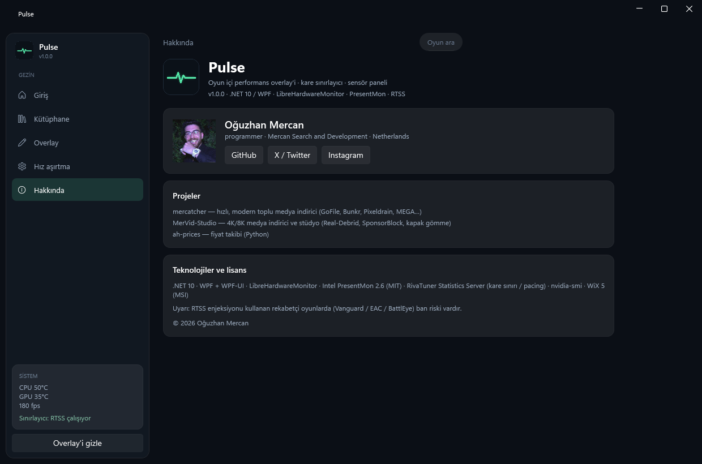
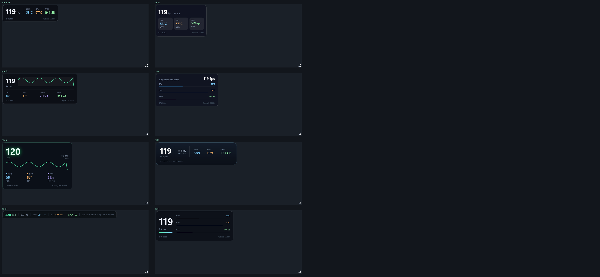

# Pulse — in-game performance overlay + control panel for Windows

One app, two halves: a clean **in-game overlay** and a **control panel** for FPS, frametime, CPU, GPU,
RAM, temperatures and fans. Windows 10/11 x64, .NET 10 WPF + WPF-UI (Fluent),
LibreHardwareMonitor (sensors), Intel PresentMon (frames/FPS), nvidia-smi (power/clock limits).

## Screenshots

Control panel:



The eight built-in overlay looks:



## Install

**Installer (recommended):** `PulseSetup.msi` → double click. Installs to `C:\Program Files\Pulse`,
adds a Start menu shortcut and uninstalls from Settings → Apps. Per-machine install (admin).

Rebuild the MSI: `powershell -File installer\build.ps1`
(requires WiX 5: `dotnet tool install --global wix --version 5.0.2` — WiX 7 is licensed, 5 is not.)

**Portable:**

```
dist\Pulse.exe
```

The `dist\` folder is portable; `Pulse.exe` and `PresentMon.exe` must stay side by side.
The app **requests admin** (UAC): CPU temperature, motherboard fans and ETW frame capture only
work elevated.

Development: `dotnet build` → `dotnet publish -c Release -o dist`

## Overlay

- Move: **Ctrl+Alt+L** (click-through is disabled while moving) → drag from the top-left, resize from the corner.
- Show/hide: **Ctrl+Alt+O**.
- While locked (`WS_EX_TRANSPARENT`) the mouse goes straight to the game; the overlay never eats a click.
- Position, size, theme and opacity are stored in `%LOCALAPPDATA%\Pulse\settings.json`.
- Eight built-in looks: `minimal`, `cards`, `graph`, `bars`, `neon` (glowing FPS + sparkline),
  `halo` (single-line premium pill), `ticker` (monospace stripe), `dual` (big FPS + filled bars).
  Each one prints the GPU and CPU model names, shortened (`NVIDIA GeForce RTX 3080` → `RTX 3080`).

### Overlay editor (themes are code)

An overlay look is just an **XAML `DataTemplate`** file: `%LOCALAPPDATA%\Pulse\themes\*.xaml`.
Panel → **Overlay** tab: edit the markup, **Apply (live)** to see it instantly, **Save** to keep it,
**Reset to default** to return to the shipped version.

Bindable values (`{Binding ...}`):

| Group | Fields |
|-------|--------|
| FPS | `Fps`, `Frametime`, `Spark` (64x40 geometry — `<Path Data="{Binding Spark}" Stretch="Fill"/>`) |
| CPU | `CpuName`, `CpuShort`, `CpuLoad`, `CpuTemp`, `CpuFan`, `CpuClock` |
| GPU | `GpuName`, `GpuShort`, `GpuLoad`, `GpuTemp`, `GpuHotspot`, `GpuFan`, `GpuFanPct`, `GpuClock`, `GpuPower`, `VramUsed`, `VramTotal` |
| RAM | `RamUsed`, `RamTotal` |
| Other | `Target` (tracked process), `Clock` |

Example line:

```xml
<TextBlock Text="{Binding CpuTemp, StringFormat='{}{0:F0}°C', TargetNullValue='--'}" />
```

Missing sensors arrive as `null` → show `--` with `TargetNullValue`.

## Library

Steam (including extra library folders), Epic, GOG, EA App, Ubisoft Connect and Battle.net are scanned
automatically; **Add EXE** takes your own game (stored in `settings.json` → `Custom`).

- Launching: Steam/Epic launcher URIs, everything else directly by exe.
- Session tracking: the clock runs while the game's process is alive and the session is saved on exit
  (`%LOCALAPPDATA%\Pulse\sessions.json`). Sessions shorter than 20 s are dropped.
- Per game: total playtime, session count, average FPS, average/peak GPU and CPU temperature.
- Average FPS skips the first 10% of samples (load-time spikes).
- **Target FPS** is stored per game (`settings.json` → `Targets`). If the session average is below
  97% of it the card shows "below target" — it is a measurement reference, not a frame cap.

### Frame limiter (RTSS integration)

Limiting goes through **RivaTuner Statistics Server**, whose "Front-Edge Sync" gives precise frame
pacing. Pulse **does not inject anything** — it only manages RTSS profiles:

- Select a game in the library → type a value into **FPS limit** → **Apply limit**
  (writes `[Framerate] Limit=N`, `LimitDenominator=1` into `Profiles\<exe>.cfg`).
- The overclocking page has a **global limit** (all games) and a switch to remove it.
- Pulse starts RTSS if it is not running; if RTSS is not installed the section stays inactive and says so.
- RTSS lives under `Program Files`, so writing profiles needs admin (the app is already elevated).

A limit of 0 removes that game's cap (`Limit=0`). Changes apply to new frames without restarting the
game; RTSS only touches the processes it hooks (WPF/DWM windows are out of scope).

**Verified (2026-11-14):** Forager (Steam) was launched from Pulse with a 60 fps limit;
`Profiles\Forager.exe.cfg` = `[Framerate] Limit=60 / LimitDenominator=1` (written by Pulse) and the
RTSS OSD showed a steady 60 fps in game. So the cap and the pacing are enforced by RTSS.
Note: RTSS did not hook a synthetic D3D11 test process of mine (real games are hooked).

> Warning: RTSS injection is risky in competitive games with aggressive kernel anti-cheat
> (Vanguard, EAC, BattlEye). Check the game's policy before using it.

### Cover art

Covers are downloaded from the Steam CDN and cached in `%LOCALAPPDATA%\Pulse\covers\`:

- Steam games: `steam:<appid>` → `steam/apps/<appid>/library_600x900.jpg` (or `header.jpg`).
- Other stores: the name is matched to an appid through Steam store search (cached in `covers.json`).
- Responses are validated as JPEG (empty/HTML bodies are never written); without a cover the tile
  shows a letter monogram.
- To re-download, delete the `covers` folder and press **Refresh**.

## Overclocking / undervolting (NVIDIA, optional)

Panel → **Overclocking**:

- **Undervolt presets** (one click): `Balanced −10%`, `Quiet −20% + 1800 MHz`, `Max efficiency −30% + 1600 MHz`.
  They combine a power limit (`-pl`) with a core clock ceiling (`-lgc 0,<MHz>`) — the safe kind of
  undervolt you can do without NVAPI (a real voltage/frequency curve needs NVAPI `Pstates20` and is
  deliberately left out).
- **Power limit** (`nvidia-smi -pl`), **core clock lock** (`-lgc min,max`), **memory clock lock** (`-lmc`).
- Empty fields are not applied; `0` removes a lock.
- **Safety:** on close, on crash and on `AppDomain.ProcessExit` the app restores `-rgc`, `-rmc` and the
  default power limit. If the process is killed, the next start sees the
  `%LOCALAPPDATA%\Pulse\tuning-active` marker and resets the clocks.
- A real core voltage/clock **offset** needs NVAPI (like Afterburner); intentionally not implemented.

## Fan control

Fans with a writable driver (GPU fans + ITE SuperIO motherboard fans) are set with a 0-100% slider.
On exit, or via **Restore fans to default**, control goes back to the firmware (`IControl.SetDefault`).
Do not touch motherboard fan headers before confirming which fan is which (set 100% and listen).

## Known limits

- **FPS needs admin + PresentMon.** PresentMon 2.x only shares its CSV on exit, so it runs in ~1.2 s
  slices: FPS refreshes about every 1.5 s. (Long-term fix: the shared-memory API or a native ETW consumer.)
- **Exclusive fullscreen** games never show an external overlay; use borderless/windowed (a Windows limit).
- GPU tuning is NVIDIA-only. On AMD/Intel the sensors work, the tuning section stays inactive.
- The first launch can spend 1-3 s scanning sensors; CPU temperature shows `--` when not elevated.
- For manually added / non-store games, session detection keys on the exe name (largest exe in the install folder).

## Files

```
%LOCALAPPDATA%\Pulse\
  settings.json      theme, overlay position, tuning values, manually added games
  sessions.json      game sessions and stats
  themes\*.xaml      editable overlay themes
  tuning-active      present => last exit was not clean, clocks are reset on start
  selftest.log       output of `Pulse.exe --selftest [exeName]` (diagnostics)
```

## Source map

- `Core/Sensors.cs` — LibreHardwareMonitor wrapper, sensor selection, fan controls
- `Core/FpsTracker.cs` — PresentMon slicing + FPS/frametime
- `Core/GpuTuner.cs` — nvidia-smi, safe rollback
- `Core/Games.cs` — store scanners, exe discovery, launching
- `Core/Sessions.cs` — sessions/stats
- `MainWindow.*` / `OverlayWindow.*` — panel and overlay
- `themes/*.xaml` — shipped themes
- `tools/PresentMon.exe` — Intel PresentMon 2.6.0 (MIT)
